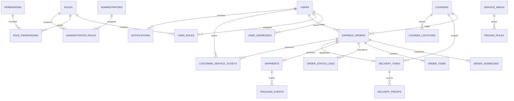

# 数据模型与 ER 设计

## 1. 统一规范

- 所有业务主键：UUID 字符串，MySQL `CHAR(36)`。
- 所有业务时间：UTC `DATETIME(3)`；应用层按用户时区显示。
- 可变业务记录统一包含 `created_at`、`updated_at`，需要软删除的主体包含 `deleted_at`。
- 金额使用 `DECIMAL(12,2)` 与 ISO 4217 币种，重量使用 `DECIMAL(10,3)`。
- `order_no` 与 `shipment_no` 分离且分别唯一。
- 地址订单化后保存快照，避免地址簿修改影响历史订单。
- 经纬度使用 `DECIMAL(10,7)`，服务区域边界暂存 GeoJSON。

## 2. ER 关系

## 3. 核心模型

- 身份与权限：`users`、`couriers`、`administrators`、`roles`、`permissions`、`user_roles`、`administrator_roles`、`role_permissions`、`refresh_sessions`。
- 地址与位置：`user_addresses`、`order_addresses`、`courier_locations`、`service_areas`。
- 订单履约：`express_orders`、`order_items`、`order_status_logs`、`shipments`、`tracking_events`、`delivery_tasks`、`delivery_proofs`。
- 运营：`pricing_rules`、`customer_service_tickets`、`notifications`、`operation_logs`。

## 4. 敏感字段

- 手机号：`phone_hash` 用于查询，`phone_encrypted` 用于受控恢复，`phone_last4` 用于脱敏展示。
- 密码：仅保存 `password_hash`。
- Refresh Token：仅保存 `token_hash`，同时保存到期和撤销时间。
- 文件：数据库保存 Storage Key、MIME、大小和访问级别，不保存客户端原始路径。

## 5. 种子数据

种子只使用 `+856209999xxxx` 虚拟手机号、中文“测试”姓名以及带“虚拟”字样的万象测试地址。所有测试订单和运单使用 `DEMO-`、`MOCK-` 前缀。
